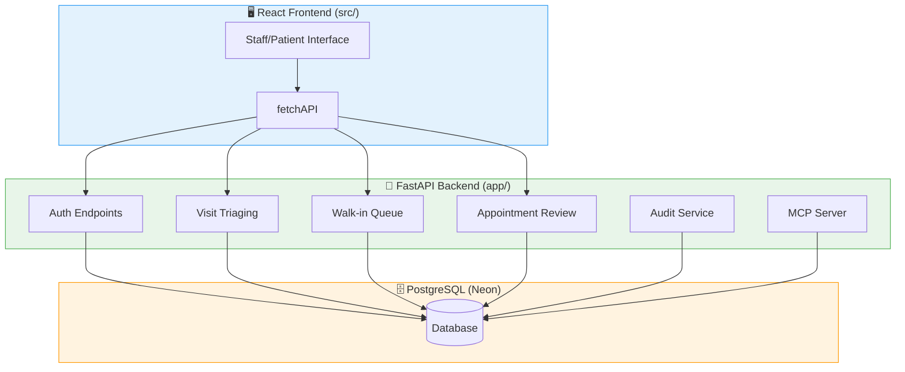
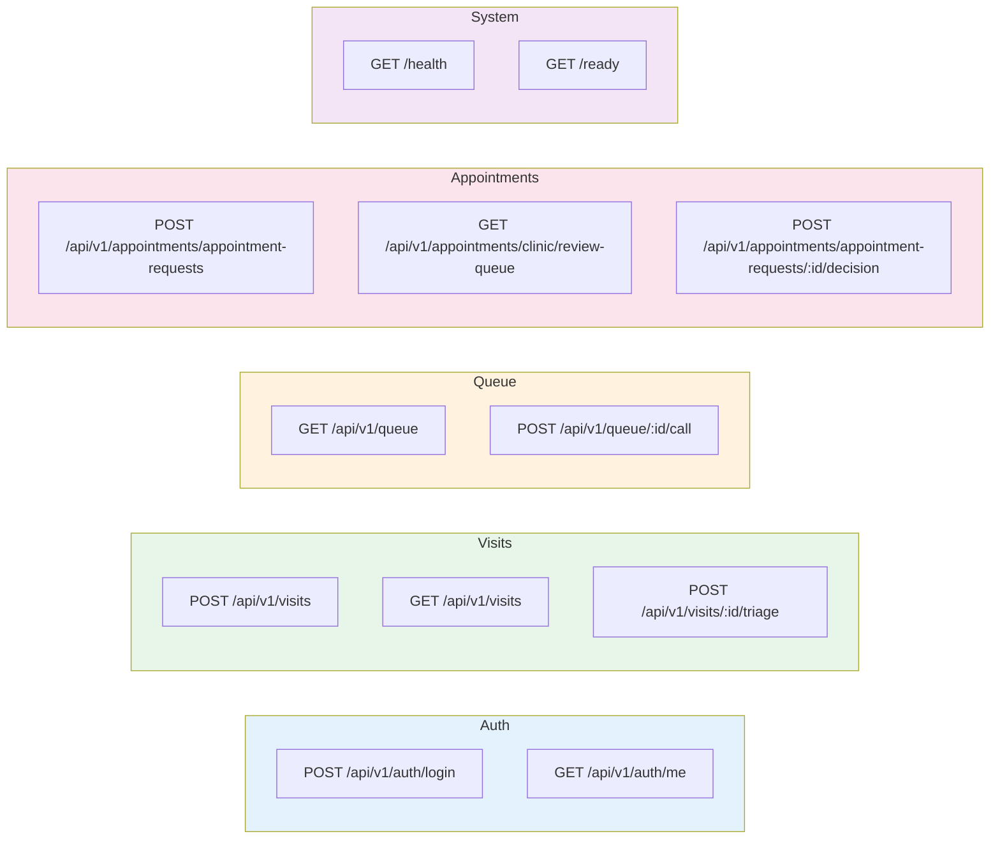
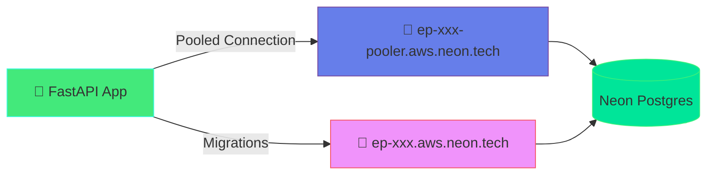

# 🏥 Mzima | Appointment and Routing Co-pilot

<div align="center">


**A synthetic-data prototype for outpatient appointment requests and clinic queue operations**

</div>

> ⚠️ **Safety Boundary:** This prototype is **not** for live care. It is not a diagnostic system and does not autonomously triage patients or change bookings or queue positions. Use **synthetic data only**.

---

## 📁 Project Layout

The repository root is the single project root. Python backend (`app/`), frontend (`src/`), migrations, seed data, docs, and tests all live at the root.

```mermaid
graph TD
    ROOT["📂 mzima/ (root)"]
    ROOT --> APP["📁 app/ (FastAPI Backend)"]
    ROOT --> SRC["📁 src/ (React + Vite)"]
    ROOT --> MIG["📁 migrations/ (Alembic)"]
    ROOT --> SCR["📁 scripts/ (Seeding & Tests)"]
    ROOT --> DOCS["📁 docs/ (Architecture, Privacy, Evals)"]
    ROOT --> INDEX["📄 index.html"]
    ROOT --> NEON["📄 neon.ts (Neon Config)"]
    ROOT --> PKG["📄 package.json"]

    APP --> ADAPT["adapters/ (FHIR, etc.)"]
    APP --> AGENT["agent/ (AI workflows)"]
    APP --> API["api/v1/ (Endpoints)"]
    APP --> CORE["core/ (Config & Security)"]
    APP --> DB["db/ (SQLAlchemy)"]
    APP --> MCP["mcp/ (Read-Only Tools)"]
    APP --> MODELS["models/ (ORM)"]
    APP --> SCHEMAS["schemas/ (Pydantic)"]
    APP --> SERVICES["services/ (Queue & Audit)"]
    APP --> MAIN["main.py (Entrypoint)"]
    APP --> VENV[".venv/ (Virtual Env)"]

    SRC --> APP_TX["App.tsx"]
    SRC --> API_TS["api.ts"]
    SRC --> MAIN_TS["main.tsx"]

    style ROOT fill:#667eea,stroke:#764ba2,color:#fff
    style APP fill:#43e97b,stroke:#38f9d7,color:#333
    style SRC fill:#f093fb,stroke:#f5576c,color:#fff
    style MIG fill:#fa709a,stroke:#fee140,color:#333
    style SCR fill:#30cfd0,stroke:#330867,color:#fff
    style DOCS fill:#a8edea,stroke:#fed6e3,color:#333
    style MAIN fill:#ffeaa7,stroke:#fdcb6e,color:#333
    style VENV fill:#dfe6e9,stroke:#b2bec3,color:#333
    style NEON fill:#00E599,stroke:#00b894,color:#fff
```



| Directory | Purpose |
|-----------|---------|
| `app/` | FastAPI API, domain models, DB session, and adapters |
| `src/` | React + TypeScript + Vite frontend |
| `migrations/` | Alembic schema migrations (initial schema setup) |
| `scripts/` | Seed data (`seed_data.py`), phase tests (`test_phase5.py`, `test_phase6.py`) |
| `docs/` | Architecture, privacy, evaluation documentation |
| `index.html` | Frontend entry point |
| `.env` | Environment variables (Neon/PostgreSQL) |
| `pyproject.toml` | Python package and dependencies |
| `neon.ts` | Neon project config (org, project, branch) |

---

## 🚀 Start Locally

```mermaid
flowchart LR
    A[Configure .env] --> B[Start Python venv]
    B --> D[Run Alembic migrations]
    D --> E[Seed Data]
    E --> F[Start FastAPI]
    F --> G[Start Frontend]
    G --> H[Open http://localhost:5173]

    style A fill:#667eea,color:#fff
    style B fill:#764ba2,color:#fff
    style D fill:#f093fb,color:#fff
    style E fill:#4facfe,color:#fff
    style F fill:#00f2fe,color:#fff
    style G fill:#43e97b,color:#fff
    style H fill:#38f9d7,color:#333
```



### Prerequisites

| Tool | Version | Purpose |
|------|---------|---------|
| Python | 3.11+ | Backend runtime |
| Node.js | 20+ | Frontend dev/build |
| PostgreSQL | 14+ | Database (local or Neon) |

### 1. Configure PostgreSQL (or Neon)

**Option A — Local PostgreSQL:**
```sql
CREATE USER mzima_user WITH PASSWORD 'replace-this-local-password';
CREATE DATABASE mzima_db OWNER mzima_user;
```

**Option B — Neon Cloud (recommended):**
```bash
npm i -g neon@latest
neon login
neon deploy --project-id noisy-snow-54213670 --branch production
# Auto-populates .env with DATABASE_URL, DATABASE_URL_UNPOOLED, NEON_BRANCH
```

### 2. Setup Python Environment

From the repository root:

```bash
cp .env.example .env
# Edit .env: set DATABASE_URL, SECRET_KEY, etc.

cd app
python3 -m venv .venv
source .venv/bin/activate       # Linux / macOS
# .venv\Scripts\activate        # Windows

pip install --upgrade pip
pip install -e .
cd ..
```

### 3. Initialize Database

```bash
alembic upgrade head              # Creates all tables
python scripts/seed_data.py        # Seeds demo users & 301 visits
```

### 4. Start the Backend API

```bash
source app/.venv/bin/activate
uvicorn app.main:app --reload --host 0.0.0.0 --port 8000
```

<|message|> Endpoint | Check |
|----------|-------|
| API | `http://127.0.0.1:8000` |
| Swagger | `http://127.0.0.1:8000/docs` |
| Health | `GET /health` |
| Readiness | `GET /ready` (tests DB connectivity) |

### 5. Start the Frontend

In a separate terminal:

```bash
npm install
npm run dev
```

Open `http://localhost:5173`. Vite proxies `/api`, `/health`, and `/ready` to `http://127.0.0.1:8000`.

### Quick Checks

```bash
pytest                                   # Smoke tests (no DB required)
npm run build                            # Frontend build
```

---

## 🏗️ Architecture



### Core Services

| Service | Description |
|---------|-------------|
| **Auth** | Login with argon2 password hashing, JWT (HS256), role-based access |
| **Visits** | Walk-in visit registration, triage workflow |
| **Queue** | Weighted FIFO queue with fast-track & wait-capping logic |
| **Appointments** | Agent-proposed appointment requests → human clinician review/decision flow |
| **Audit** | Immutable event logging for security & compliance |
| **MCP** | Read-only interface exposing queue summary & pending reviews |

---

## 🔑 Authentication & Roles

| Role | Permissions |
|------|-------------|
| `CLERK` | Register visits, login/logout |
| `NURSE` | Register visits, triage, queue operations |
| `SHIFT_LEAD` | All above + approve/reject appointment requests |

**Default seeded accounts** (for testing only):
| Username | Password | Role |
|----------|----------|------|
| `clerk1` | `clerkpass123` | CLERK |
| `nurse1` | `nursepass123` | NURSE |
| `lead1` | `leadpass123` | SHIFT_LEAD |

---

## 📋 API Reference



### All Endpoints

| Method | Path | Description |
|--------|------|-------------|
| `GET` | `/health` | Liveness check |
| `GET` | `/ready` | DB connectivity check |
| `POST` | `/api/v1/auth/login` | Login & receive JWT |
| `GET` | `/api/v1/auth/me` | Current user info |
| `POST` | `/api/v1/visits` | Create walk-in visit |
| `GET` | `/api/v1/visits` | List visits |
| `POST` | `/api/v1/visits/{id}/triage` | Complete triage |
| `GET` | `/api/v1/queue` | Live queue |
| `POST` | `/api/v1/queue/{id}/call` | Call next patient |
| `POST` | `/api/v1/appointments/appointment-requests` | Create appointment request |
| `GET` | `/api/v1/appointments/clinic/review-queue` | Pending reviews |
| `POST` | `/api/v1/appointments/appointment-requests/{id}/decision` | Clinician decision |

---

## 🧪 Testing

```bash
# API smoke tests (in-memory, no DB required)
pytest

# FHIR adapter + MCP tools
python scripts/test_phase5.py

# Agent safety guardrails (human-in-loop enforced)
python scripts/test_phase6.py

# Frontend production build
npm run build
```

### Test Coverage

- **Phase 5**: Mock FHIR adapter export, read-only MCP tools (queue digest, pending reviews)
- **Phase 6**: Agent proposes slot → invariant check (does NOT auto-approve) → explicit clinician sign-off
- **Safety invariant**: AI agent **cannot** autonomously approve appointment requests; human clinician sign-off is mandatory

---

## 🛡️ Safety & Compliance

|message| Concern | Handling |

| Patient data | Synthetic only; never use real patient info |
| Autonomous triage | **Prohibited** — no auto-triage or auto-approval |
| Audit trail | Immutable audit event logging |
| PII | No real PII in code, commits, issues, or demos |
| Privacy docs | [docs/DATA_AND_PRIVACY.md](docs/DATA_AND_PRIVACY.md) |

---

## 🔒 Neon Database Integration



### Neon Setup

```bash
# Install and authenticate
npm i -g neon@latest
neon login

# Deploy (provisions Postgres, pulls .env vars)
neon deploy --project-id noisy-snow-54213670 --branch production
```

The `.env` file auto-populates with:
- `DATABASE_URL` → pooled connection (for app traffic)
- `DATABASE_URL_UNPOOLED` → direct connection (for migrations)
- `NEON_BRANCH` → `production`

### Branching Workflow

```
neon checkout -b feature-branch        # Create isolated branch
neon deploy --branch feature-branch    # Deploy schema changes
neon branches delete feature-branch    # Cleanup when done
```

---

## 📊 Data & Privacy

- **Synthetic data only** — no real patient identifiers or PHI
- **No persistent file storage** — all data lives in PostgreSQL
- **Audit logged** — every triage decision, queue call, and appointment decision creates an immutable audit event
- **Passwords** — argon2 password hashing, configurable expiration

See [docs/DATA_AND_PRIVACY.md](docs/DATA_AND_PRIVACY.md) for details.

---

## 🤖 Planned (Not Yet Implemented)

| Feature | Status | Docs |
|---------|--------|------|
| Local AI agent (Ollama) | 🔴 Planned | [docs/MZIMA_SYSTEM_DESIGN.md](docs/MZIMA_SYSTEM_DESIGN.md) |
| MCP appointment routing | 🔴 Planned | [docs/ARCHITECTURE.md](docs/ARCHITECTURE.md) |
| Appointment slots | 🔴 Planned | — |
| Agent proposal/commit | 🔴 Planned | Phase 6 tests are scaffolding |

---

## 📝 Documentation

| Doc | Purpose |
|-----|---------|
| [docs/MZIMA_SYSTEM_DESIGN.md](docs/MZIMA_SYSTEM_DESIGN.md) | Product requirements and acceptance criteria |
| [docs/ARCHITECTURE.md](docs/ARCHITECTURE.md) | Component boundaries & data model |
| [docs/DATA_AND_PRIVACY.md](docs/DATA_AND_PRIVACY.md) | Synthetic data policy, retention |
| [docs/EVALS.md](docs/EVALS.md) | Test plan (not measured results) |
| [docs/FRONTEND_DESIGN.md](docs/FRONTEND_DESIGN.md) | Frontend design and scope |

---

## 📜 Licence

See [LICENSE](LICENSE). All code and documentation are provided as-is without warranty.

---

<div align="center">

**Built with passion and scientific rigor 🔬**

</div>